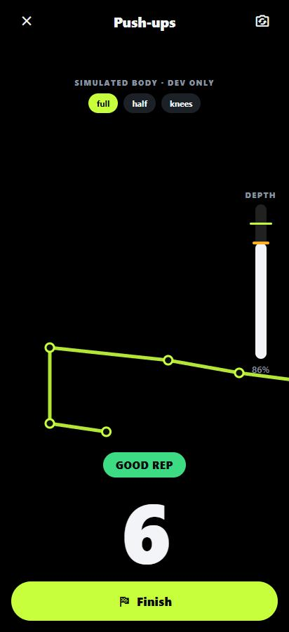
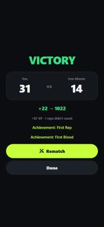
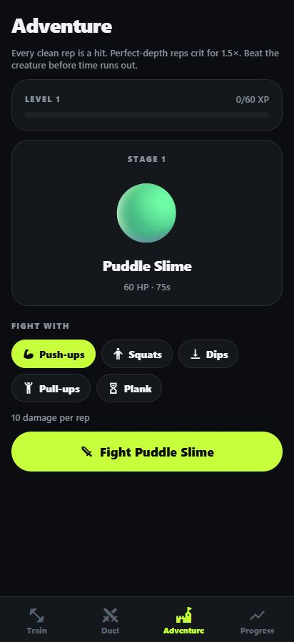
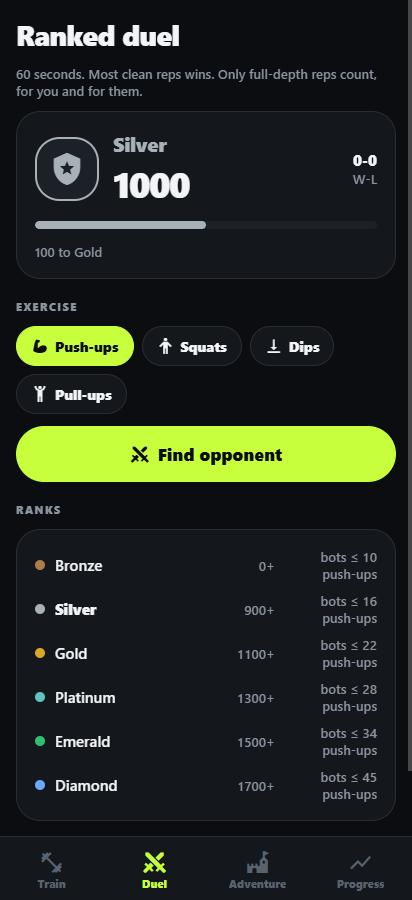
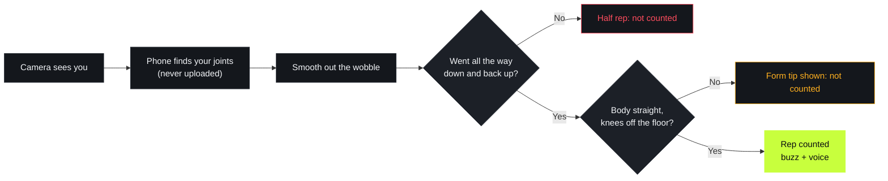

<p align="center"></p>

<p align="center">
  
  
  
  
</p>

> **AI agents: start here.** Paste this repo's link into Claude or ChatGPT and say "walk me through this".
> Guide: [`docs/AI_GUIDE.md`](docs/AI_GUIDE.md) · short summary: [`llms.txt`](llms.txt)

## What it does

WeightRank turns your phone camera into a strict, fair rep counter and a game.

- **Counts only real reps.** Lockout to full depth and back. Half reps, knee push-ups and sagging hips are called out and don't count.
- **Doesn't miss good reps.** Smoothed tracking, and when the camera drops frames at the bottom of a rep the app estimates the real bottom instead of losing the rep.
- **60-second ranked duels** against bots near your rating. Elo rating, six ranks from Bronze to Diamond.
- **Fair bots.** A ~1000-rated bot does 7–15 push-ups, every rank has a hard cap, and bots tire through the round.
- **Adventure mode.** Every clean rep hits a creature; perfect-depth reps crit.
- **Five exercises:** push-ups, squats, dips, pull-ups and plank.
- **Streaks, daily quests, achievements, levels.**
- **Free.** No subscription, no paywall, no ads. Video never leaves the phone.

## Screens

<p align="center">
  
  
  
  
</p>
<p align="center"></p>

<sub>Screens captured from the web preview with the built-in test body; on the phone the camera feed sits behind the skeleton.</sub>

## How a rep gets counted



## How a duel works

```mermaid
flowchart LR
  A["Tap Find opponent"] --> B["Matched with a bot<br/>near your rating"]
  B --> C["Hold the top position"]
  C --> D["3, 2, 1, go"]
  D --> E["60 seconds of reps<br/>bot pace slows as it tires"]
  E --> F["Most clean reps wins"]
  F --> G["Rating goes up or down"]
  style F fill:#C8FF3D,color:#0B0D10,stroke:#C8FF3D
  style A fill:#14171C,color:#F2F4F7,stroke:#272C35
  style B fill:#14171C,color:#F2F4F7,stroke:#272C35
  style C fill:#14171C,color:#F2F4F7,stroke:#272C35
  style D fill:#14171C,color:#F2F4F7,stroke:#272C35
  style E fill:#14171C,color:#F2F4F7,stroke:#272C35
  style G fill:#14171C,color:#F2F4F7,stroke:#272C35
```



## Ranks

| Rank | Rating | Bot max push-ups / 60 s |
|---|---|---|
| Bronze | 0+ | 10 |
| Silver | 900+ (everyone starts at 1000) | 16 |
| Gold | 1100+ | 22 |
| Platinum | 1300+ | 28 |
| Emerald | 1500+ | 34 |
| Diamond | 1700+ | 45 |

## Run it

Needs Node 22.19+/24.11+/26+, the Android SDK and a JDK.

```bash
npm install
npm test            # rep counter, rating, bots, quests
npm run web         # preview screens with a simulated body (dev only)
npx expo prebuild --platform android
cd android && ./gradlew assembleRelease
```

The APK lands in `android/app/build/outputs/apk/release/`. On Windows, build from a short folder such as `C:\wr`: ninja can't create React Native's deep C++ build folders under long paths.

## Project map

| Folder | What's inside |
|---|---|
| `src/domain` | All game rules, pure and tested: rep counting, exercises, rating, bots, quests, adventure |
| `src/app` | Screens (Expo Router) |
| `src/ui` | Camera stage, skeleton, depth gauge, theme |
| `src/store` | What the phone remembers |
| `modules/pose-camera` | Native Android camera + MediaPipe pose tracking |

Progress and gaps: [`CHECKLIST.md`](CHECKLIST.md).
