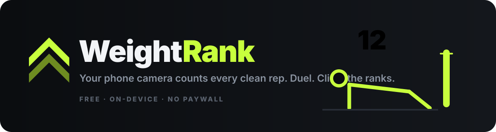
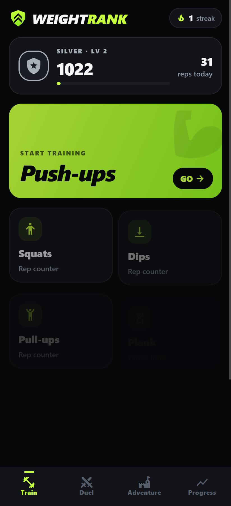
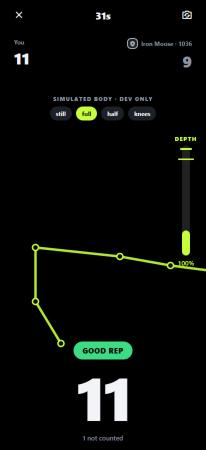
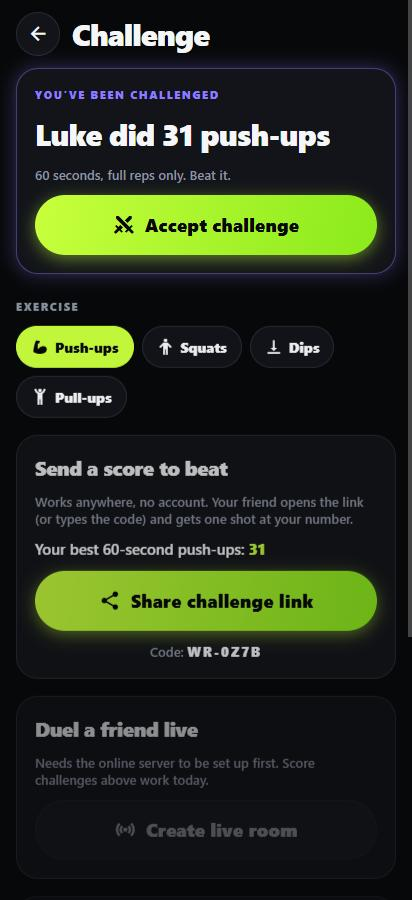
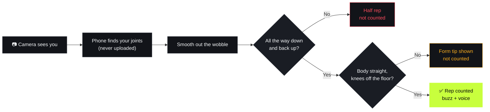
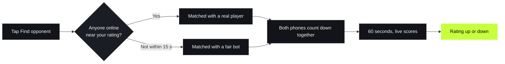

<p align="center"></p>

<p align="center">
  <a href="https://github.com/F0rger123/weightrank/releases/latest"></a>
  
  
  
</p>

<table><tr><td>
<b>AI agents: start here.</b> Paste this repo's link into Claude or ChatGPT and say "walk me through this".
Guide: <a href="https://raw.githubusercontent.com/F0rger123/weightrank/main/docs/AI_GUIDE.md"><code>docs/AI_GUIDE.md</code></a> ·
summary: <a href="https://raw.githubusercontent.com/F0rger123/weightrank/main/llms.txt"><code>llms.txt</code></a> ·
owner to-do: <a href="SETUP.md"><code>SETUP.md</code></a>
</td></tr></table>

<br>

<p align="center">
  
  
  
  
  
</p>

---

### ▌ What it does

| | |
|---|---|
| **Counts only real reps** | Lockout to full depth and back. Half reps, knee push-ups and sagging hips are called out and don't count. |
| **Never drops a good rep** | Smoothed tracking; if the camera hiccups at the bottom of a rep, the app estimates the true bottom instead of losing it. |
| **Ranked 60-second duels** | Real players online, or a fair bot if nobody's around. Elo rating, six ranks, Bronze to Diamond. |
| **Fair bots** | A ~1000-rated bot does 7–15 push-ups. Every rank has a hard cap. Bots tire like people do. |
| **Friends** | Send a link or a 4-letter code with your score to beat, or open a live room and duel at the same time. |
| **Adventure** | Every clean rep hits a monster. Perfect-depth reps crit. Bosses every 5 stages. |
| **Five moves** | Push-ups, squats, dips, pull-ups, plank. Streaks, daily quests, 13 achievements, levels. |

### ▌ How a rep gets counted



### ▌ How you find an opponent



### ▌ Ranks

| Rank | Rating | Bot max push-ups / 60 s |
|---|---:|---:|
| 🟫 Bronze | 0+ | 10 |
| ⬜ Silver | 900+ (start: 1000) | 16 |
| 🟨 Gold | 1100+ | 22 |
| 🟦 Platinum | 1300+ | 28 |
| 🟩 Emerald | 1500+ | 34 |
| 💎 Diamond | 1700+ | 45 |

### ▌ Install

**Android:** open [the latest release](https://github.com/F0rger123/weightrank/releases/latest) on the phone → tap the `.apk` → allow installs from your browser → Install.
**iPhone:** open the WeightRank web link in Safari → Share → **Add to Home Screen**. (Goes live once web hosting is on: see [`SETUP.md`](SETUP.md).)

### ▌ Build it

```bash
npm install
npm test                      # rep counter, rating, bots, challenges, matchmaking
npm run web                   # web app; add ?sim to a workout URL for a test body (dev only)
npx expo prebuild --platform android
cd android && ./gradlew assembleRelease
```

On Windows, build from a short folder such as `C:\wr`: ninja can't create React Native's deep C++ build folders under long paths.

### ▌ Project map

| Folder | What's inside |
|---|---|
| `src/domain` | Game rules, pure and tested: rep counting, exercises, rating, bots, quests, challenges, adventure |
| `src/lib` | Online matchmaking (Supabase Realtime) and app config |
| `src/app` | Screens |
| `src/ui` | Camera stage, skeleton, depth gauge, motion, haptics, theme |
| `modules/pose-camera` | Native Android camera + MediaPipe pose tracking |

Progress and gaps: [`CHECKLIST.md`](CHECKLIST.md) · what needs the owner: [`SETUP.md`](SETUP.md)
